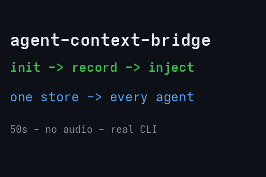

# 🌉 Agent Context Bridge (ACB)

[](https://github.com/shenn667/agent-context-bridge/actions/workflows/ci.yml)
[](https://pypi.org/project/agent-context-bridge/)
[](https://www.python.org/)
[](https://opensource.org/licenses/MIT)

> **Universal, zero-dependency context & memory bridge for autonomous coding agents.**
> Share project decisions, architectural constraints, and task progress between **Hermes Agent**, **Claude Code**, **OpenCode**, and **Codex**.

> ⏱️ **The 10-second version:** every AI coding tool starts blind — decisions made in one agent are lost to the next. ACB records them once (`acb record`) and replays them in each agent's native format (`acb inject`, hook, or MCP tool).



*50s, no audio: `init` → `record` → `list` → `inject` for Claude & Hermes. One store (`.agent_bridge/`) → every agent.*

---

## 🔌 Claude-native: MCP server `acb-mcp` (readonly)

Claude Code / Claude Desktop can query shared context directly via stdio MCP — no hook needed. The server exposes 2 strictly **readonly** tools: `acb_search` and `acb_status`. (`prune` stays CLI-only and never runs inside MCP.)

Copy-paste into `claude.json` (Claude Code) or Claude Desktop MCP config:

```json
{
  "mcpServers": {
    "acb": {
      "command": "acb-mcp",
      "args": ["--dir", "/path/to/your/project"],
      "transport": "stdio"
    }
  }
}
```

Then ask Claude: *"search ACB for the auth decision"* → `acb_search` returns the matching records. Verify with `acb_status`.

Prefer hooks? One command each — `acb hooks claude --install` writes `.claude/settings.json` (SessionStart → `acb inject --target claude`), `--print` previews it.

---

## ✨ What's new in v0.3.1

| Command | What it does |
|---|---|
| `acb search "query"` | Full-text search over shared context, newest-first (`--limit`, `--json`) |
| `acb status [--json]` | Store health: record count, size, agent targets covered |
| `acb audit` | Integrity check of `records.jsonl` (corrupt lines, missing fields) |
| `acb prune --keep-last N [--dry-run]` | Keep the N most recent records, drop the rest |

```bash
acb search "SQLite auth"      # 2 hits, most recent first
acb status                    # 3 records, 1642 bytes, hermes/claude/opencode/codex
acb prune --keep-last 20 --dry-run   # preview before trimming
```

---

## 📊 Measured token savings: −98.7%

> Real benchmark from `QA_REPORT_v0.3.0.md` (v0.3.0, 30-record store, tokens ≈ chars/4, measured not estimated):
>
> | Scenario | ~Tokens |
> |---|---|
> | Naive: re-read sources at agent switch (7 .py, 60 768 chars) | **15 192** |
> | ACB `inject` (bounded to 5 latest, constant cost) | **198** |
>
> **(15 192 − 198) / 15 192 = 98.7% saved.** Also −95.7% vs re-reading decision docs (4 555 → 198) and −90.5% vs full context file (2 078 → 198).
>
> Key property: `inject` cost stays **flat** as the store grows; naive re-reading grows linearly. `search` returns only relevant hits.

---

## 💡 The Problem: Multi-Agent Context Fragmentation

When switching between modern AI developer tools (e.g., Claude Code in terminal, Hermes swarm in background, OpenCode in IDE):
1. **Each agent starts blind**: context learned by one agent is lost to the next.
2. **Token waste**: agents re-read entire repos to rediscover decisions already made (see benchmark above).
3. **No persistent audit trail**: critical architectural choices disappear with session resets.

**ACB** solves this with a lightweight, file-backed offline store (`.agent_bridge/`) and native adapters per agent.

---

## ✨ Features

- **Zero Runtime Dependencies**: pure stdlib (`argparse`, `json`, `dataclasses`, `datetime`).
- **Offline & Local-First**: no daemon, no database, no network. Works 100% offline.
- **Multi-Agent Adapters**: native formatters for **Hermes**, **Claude Code**, **OpenCode**, **Codex**.
- **MCP-native**: `acb-mcp` stdio server, readonly tools for Claude.
- **Human-Readable & Machine-Parseable**: `records.jsonl` + `SHARED_CONTEXT.md` maintained automatically.

---

## 📦 Installation

```bash
pip install agent-context-bridge
```

Or from source:

```bash
git clone https://github.com/shenn667/agent-context-bridge.git
cd agent-context-bridge
pip install -e .
```

---

## 🚀 Quickstart

```bash
acb init

acb record \
  --agent hermes-dev \
  --topic "Database Engine" \
  --summary "Adopted SQLite WAL mode for local agent state storage" \
  --details "PostgreSQL required Docker; SQLite gives zero-latency offline access." \
  --tag db --tag architecture

acb list
acb search "SQLite"

acb inject --target claude    # Claude Code SessionStart hook
acb inject --target hermes   # Hermes system context
acb inject --target opencode # OpenCode
```

---

## ✅ Local demo (3 commands)

Reproducible from a fresh clone — proves install + record/inject + consistent version:

```bash
pip install -e .
acb init --dir /tmp/acb-demo && acb record --dir /tmp/acb-demo --agent hermes-dev --topic "Demo" --summary "Bridge OK" && acb inject --dir /tmp/acb-demo --target hermes
acb --version
```

Expected: `agent-bridge 0.3.1` (matches `pyproject.toml`, `__init__.__version__`, and tag `v0.3.1` — `release.yml` refuses publish on mismatch).

---

## 🏗️ Architecture

```
                      ┌──────────────────────┐
                      │  Your Project Repo   │
                      └──────────┬───────────┘
                                 │
                     .agent_bridge/SHARED_CONTEXT.md
                     .agent_bridge/records.jsonl
                                 │
           ┌─────────────────────┼─────────────────────┐
           ▼                     ▼                     ▼
     ┌───────────┐         ┌───────────┐         ┌───────────┐
     │  Hermes   │         │Claude Code│         │ OpenCode  │
     │  Adapter  │         │  Adapter  │         │  Adapter  │
     └───────────┘         └───────────┘         └───────────┘
              Claude Desktop/Code ◄── acb-mcp (stdio, readonly)
```

---

## 🧪 Running Tests

```bash
pytest -v   # 73/73 green on v0.3.1
```

---

## 📄 License

Open-source under the [MIT License](LICENSE).
Authored by **shenn667** ([lehdev@yandex.com](mailto:lehdev@yandex.com)).

<!-- mcp-name: io.github.shenn667/agent-context-bridge -->
